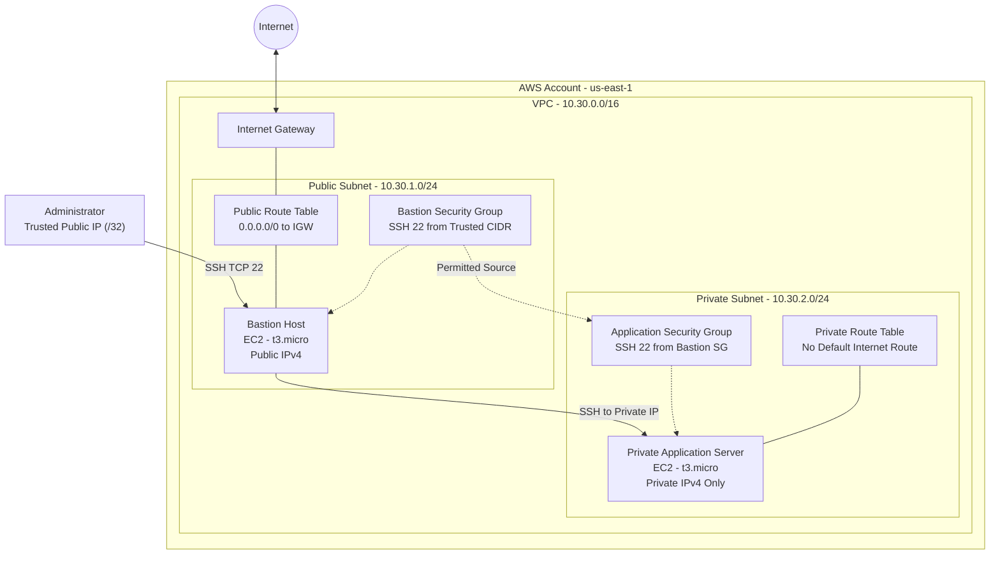

# Project 3: Secure Cloud Network with Private Workloads on AWS

## Overview

This project demonstrates how to design and deploy a secure, segmented AWS network using Terraform. It uses a public bastion host as a controlled administrative entry point to access an application server located in a private subnet.

The application server does not have a public IPv4 address, and SSH access is restricted through security group rules. Terraform provisions and manages the infrastructure as code, making the environment reproducible, maintainable, and easier to validate.

The project focuses on foundational cloud networking, infrastructure automation, network segmentation, access control, and secure administration.

## Project Objectives

- Build an AWS Virtual Private Cloud (VPC) using Terraform.
- Create separate public and private subnets.
- Configure an Internet Gateway and public route table.
- Deploy a bastion host in the public subnet.
- Deploy an application server in the private subnet.
- Prevent direct public internet access to the private application server.
- Restrict SSH access to trusted administrator IP addresses.
- Allow SSH from the bastion host to the private application server using security group references.
- Enable encrypted EBS root volumes.
- Require Instance Metadata Service Version 2 (IMDSv2).
- Validate the infrastructure using Terraform and AWS CLI commands.
- Document the deployment and cleanup procedures.

## Architecture Diagram

The following architecture illustrates the intended infrastructure.



### Architecture Components

| Component | Purpose |
| --- | --- |
| AWS VPC | Provides an isolated virtual network for the infrastructure. |
| Public subnet | Hosts the bastion server and provides a route to the Internet Gateway. |
| Private subnet | Hosts the application server without a public IPv4 address. |
| Internet Gateway | Provides internet connectivity to appropriately routed public resources. |
| Public route table | Routes internet-bound traffic through the Internet Gateway. |
| Private route table | Keeps the private subnet without a default internet route in the baseline design. |
| Bastion host | Provides a controlled SSH entry point into the environment. |
| Bastion security group | Restricts inbound SSH to a trusted administrator CIDR. |
| Application security group | Allows SSH only from the bastion security group. |
| EC2 instances | Provide the compute resources for administration and private workloads. |
| Terraform | Provisions and manages the infrastructure as code. |

## Network Design

The following values describe the example configuration. Confirm the actual values in the Terraform variables and plan before deployment.

| Setting | Value |
| --- | --- |
| Cloud provider | Amazon Web Services (AWS) |
| Region | `us-east-1` |
| VPC CIDR | `10.30.0.0/16` |
| Public subnet CIDR | `10.30.1.0/24` |
| Private subnet CIDR | `10.30.2.0/24` |
| Bastion instance type | `t3.micro` |
| Application instance type | `t3.micro` |
| Operating system | Ubuntu Server 22.04 LTS |
| Root disk | 8 GiB gp3 EBS volume, encrypted |
| Administrator protocol | SSH |
| SSH port | TCP 22 |
| Metadata configuration | IMDSv2 required |
| Infrastructure as code | Terraform |

### Public Subnet

The public subnet contains the bastion host.

The subnet uses a route table with a default route to the Internet Gateway. The bastion host receives a public IPv4 address so that an authorized administrator can connect to it from a trusted network.

The bastion security group restricts inbound SSH traffic to the administrator's configured public IP address or trusted CIDR range.

### Private Subnet

The private subnet contains the application server.

The application server does not receive a public IPv4 address. Its security group allows SSH connections from the bastion security group rather than from arbitrary internet addresses.

The baseline private route table has no default route to an Internet Gateway or NAT Gateway. Consequently, the application server does not have general outbound internet connectivity in this design.

If software updates or outbound application traffic are required, an explicit and appropriately secured egress design must be added.

## Security Controls

### 1. Restricted SSH Access

The bastion host accepts SSH connections only from the configured trusted administrator CIDR.

For an individual administrator IP address, use a `/32` CIDR where appropriate.

Example:

```text
203.0.113.25/32
```

This is a documentation-only example address. Replace it with your actual trusted public IP address.

Do not expose SSH to `0.0.0.0/0`.

### 2. Private Application Server

The application server has no public IPv4 address. Administrators access it through the bastion host using its private IP address.

### 3. Security Group Referencing

The application security group references the bastion security group as the permitted source for SSH traffic.

This approach avoids hardcoding the bastion's IP address into the application security group rule and limits access to resources associated with the approved source security group.

### 4. Encrypted Storage

The EC2 root EBS volumes are configured for encryption to help protect data stored on disk.

### 5. IMDSv2

The EC2 instances require Instance Metadata Service Version 2, which uses session-oriented tokens for metadata requests.

### 6. Least Privilege

Use an AWS identity with only the permissions required to provision and manage this lab.

Do not store AWS access keys, passwords, or private SSH keys in Terraform source files or commit them to version control.

### 7. Infrastructure Review

Run Terraform formatting, validation, and planning commands before applying changes. Review the plan to ensure the intended region, network ranges, security rules, and resource types are correct.

## Repository Structure

The expected Terraform project structure is:

```text
secure-cloud-network/
├── README.md
├── .gitignore
└── aws/
    └── terraform/
        ├── versions.tf
        ├── variables.tf
        ├── main.tf
        ├── outputs.tf
        └── terraform.tfvars.example
```

Your actual repository may contain additional files, modules, scripts, or automation workflows.

### File Descriptions

| File | Description |
| --- | --- |
| `README.md` | Project documentation, architecture, and operating instructions. |
| `.gitignore` | Excludes local Terraform state, variable files, keys, and other sensitive artifacts. |
| `versions.tf` | Defines Terraform and provider version requirements. |
| `variables.tf` | Declares configurable Terraform inputs. |
| `main.tf` | Defines AWS networking, security groups, key pair, AMI lookup, and EC2 resources. |
| `outputs.tf` | Exposes useful resource identifiers and connection information. |
| `terraform.tfvars.example` | Provides example values for required or optional Terraform variables. |

## Prerequisites

Before deploying, ensure the following tools and resources are available:

- An AWS account.
- AWS CLI v2.
- Terraform compatible with the version constraint in `versions.tf`.
- An SSH client such as OpenSSH.
- AWS credentials configured through an appropriate profile or supported credential mechanism.
- Permissions to create the required VPC, networking, security group, key pair, and EC2 resources.
- A dedicated SSH key pair for the lab.

### Verify the Installed Tools

```bash
# Confirm that Terraform is installed.
terraform version

# Confirm that the AWS CLI is installed.
aws --version

# Confirm the AWS identity currently being used.
aws sts get-caller-identity
```

Verify that the account and identity are correct before creating infrastructure.

## Configuration

### 1. Navigate to the Terraform Directory

Update this example path if your project is stored elsewhere.

```bash
# Navigate to the AWS Terraform project directory.
cd ~/projects/secure-cloud-network/aws/terraform
```

### 2. Create the Local Variables File

```bash
# Copy the example variables file to a local configuration file.
cp terraform.tfvars.example terraform.tfvars
```

Edit `terraform.tfvars` and provide the appropriate values for the variables declared in `variables.tf`.

Typical inputs may include:

- AWS region.
- Project name.
- Trusted SSH CIDR.
- EC2 instance type.
- Path to the public SSH key.

Use the actual variable names defined in your project rather than assuming these names match exactly.

### 3. Generate an SSH Key Pair

If you do not already have a dedicated key pair for this lab, you can generate one using OpenSSH.

```bash
# Generate a dedicated Ed25519 SSH key pair.
ssh-keygen -t ed25519 \
  -f ~/.ssh/secure-cloud-network \
  -C "secure-cloud-network"

# Restrict permissions on the private key.
chmod 600 ~/.ssh/secure-cloud-network
```

The public key is normally stored at:

```text
~/.ssh/secure-cloud-network.pub
```

Configure Terraform to use the public key. Keep the private key secure and out of version control.

### 4. Review the Terraform Variables

```bash
# Review the available Terraform input variables.
sed -n '1,240p' variables.tf

# Review the example variable values.
sed -n '1,200p' terraform.tfvars.example
```

### 5. Protect Sensitive Files

Check the repository status and confirm local configuration files are excluded where appropriate.

```bash
# Check for uncommitted files and potentially sensitive artifacts.
git status --short

# Check whether the local Terraform variable file is ignored.
git check-ignore terraform.tfvars
```

The `.gitignore` should normally exclude at least:

```gitignore
# Terraform working directories and local state.
.terraform/
*.tfstate
*.tfstate.*
crash.log
crash.*.log

# Local Terraform variable files.
terraform.tfvars
terraform.tfvars.json
*.auto.tfvars
*.auto.tfvars.json

# Saved plans may contain sensitive configuration.
tfplan
*.tfplan

# Private SSH keys.
*.pem
id_rsa
id_ed25519
```

Review these patterns against your project's needs. If you intentionally commit a sanitized example variable file, keep it separate from real environment-specific values.

## Deployment

Run the following commands from the Terraform directory.

### Step 1: Initialize Terraform

```bash
# Initialize the working directory and install required providers.
terraform init
```

### Step 2: Format the Configuration

```bash
# Format Terraform files consistently.
terraform fmt -recursive
```

### Step 3: Validate the Configuration

```bash
# Check Terraform syntax and internal configuration consistency.
terraform validate
```

### Step 4: Create and Review an Execution Plan

```bash
# Preview the infrastructure changes and save the plan locally.
terraform plan -out=tfplan
```

Before proceeding, confirm that the plan targets the intended AWS account and region.

Review the planned CIDR ranges, security group rules, instance types, storage configuration, and resources to be created.

### Step 5: Apply the Plan

```bash
# Apply the previously reviewed plan.
terraform apply tfplan
```

Only approve the operation after confirming the plan is appropriate.

Terraform should provision the resources declared in the configuration, which may include the VPC, subnets, route tables, Internet Gateway, security groups, key pair, and EC2 instances.

The actual resource count depends on the implementation in your repository.

## Post-Deployment Validation

After a successful deployment, validate the resources and their security settings.

### 1. Review Terraform Outputs

```bash
# Display the outputs defined by the project.
terraform output

# Display all outputs in JSON format.
terraform output -json
```

Use the actual output names defined in `outputs.tf` when retrieving individual values.

Expected results include the relevant resource IDs and connection details, where those outputs are defined.

### 2. Verify the EC2 Instances

The following example filters instances using a project tag. Update the tag key and value to match your Terraform configuration.

```bash
# List EC2 instances tagged for this project.
aws ec2 describe-instances \
  --region us-east-1 \
  --filters "Name=tag:Project,Values=secure-cloud-network" \
  --query 'Reservations[].Instances[].{Name:Tags[?Key==`Name`]|[0].Value,State:State.Name,PublicIP:PublicIpAddress,PrivateIP:PrivateIpAddress,Subnet:SubnetId,Instance:InstanceId}' \
  --output table
```

Verify the following:

- The bastion host is running.
- The bastion host is located in the public subnet.
- The bastion host has a public IPv4 address.
- The application server is running in the private subnet.
- The application server has a private IPv4 address.
- The application server has no public IPv4 address.

If the command returns no instances, check the project tag and region before assuming the deployment failed.

### 3. Verify Security Group Rules

```bash
# Inspect security group ingress rules in the configured region.
aws ec2 describe-security-groups \
  --region us-east-1 \
  --query 'SecurityGroups[].{Name:GroupName,Id:GroupId,Ingress:IpPermissions}' \
  --output json
```

Confirm that:

- The bastion security group allows SSH only from the trusted administrator CIDR.
- The application security group allows SSH from the bastion security group.
- No unexpected public SSH ingress rules exist.

### 4. Verify Route Tables

```bash
# Display route tables and their routes.
aws ec2 describe-route-tables \
  --region us-east-1 \
  --output json
```

Confirm that:

- The public subnet is associated with the correct public route table.
- The public route table has a default route to the Internet Gateway.
- The private subnet is associated with the intended private route table.
- The private route table has no default route to an Internet Gateway or NAT Gateway in this baseline design.

### 5. Verify SSH Connectivity

Test the administrative path:

1. Connect to the bastion host from the trusted administrator network.
2. Connect from the bastion host to the application server using the application's private IP address.
3. Confirm that the private application server is not directly accessible through a public IP address.

Successful connectivity through the bastion demonstrates the intended administrative access path.

## Connecting to the Bastion Host

Retrieve the bastion public IP address from the Terraform outputs or AWS console.

Ensure that your private key has restrictive permissions:

```bash
# Restrict permissions on the private key.
chmod 600 ~/.ssh/secure-cloud-network
```

Connect to the bastion:

```bash
# Replace BASTION_PUBLIC_IP with the actual public IP address.
ssh -i ~/.ssh/secure-cloud-network ubuntu@BASTION_PUBLIC_IP
```

The username `ubuntu` is appropriate for the Ubuntu AMI used in this example. Verify the username if you change the operating system image.

## Connecting to the Private Application Server

The private application server should be accessed through the bastion host.

You can use SSH ProxyJump from your local workstation:

```bash
# Replace BASTION_PUBLIC_IP and APP_PRIVATE_IP with actual addresses.
# ProxyJump establishes the SSH connection through the bastion.
ssh -i ~/.ssh/secure-cloud-network \
  -o "ProxyJump=ubuntu@BASTION_PUBLIC_IP" \
  ubuntu@APP_PRIVATE_IP
```

Alternatively, use an SSH configuration entry:

```sshconfig
# Configure the bastion as a jump host.
Host lab-bastion
    HostName BASTION_PUBLIC_IP
    User ubuntu
    IdentityFile ~/.ssh/secure-cloud-network
    IdentitiesOnly yes

# Route private instance connections through the bastion.
Host lab-app
    HostName APP_PRIVATE_IP
    User ubuntu
    IdentityFile ~/.ssh/secure-cloud-network
    IdentitiesOnly yes
    ProxyJump lab-bastion
```

Replace both placeholder addresses with the actual IP addresses.

After saving the configuration to `~/.ssh/config`, connect with:

```bash
# Connect to the private application server through the bastion.
ssh lab-app
```

The bastion must be able to reach the private IP of the application server, and the application security group must allow SSH from the bastion security group.

## Troubleshooting

| Problem | Possible cause and resolution |
| --- | --- |
| `terraform init` fails | Check internet access, Terraform version requirements, provider configuration, and AWS credentials. |
| AWS returns `AccessDenied` | Confirm the active identity and required permissions. |
| SSH to the bastion times out | Verify the public IP, Internet Gateway, public route table, and trusted SSH CIDR. |
| SSH returns `Permission denied (publickey)` | Check the SSH key, key pair configuration, file permissions, and login username. |
| Private server is unreachable | Confirm the bastion is running, use the private IP, and inspect application security group rules. |
| Private server cannot access the internet | This is expected in the baseline design because there is no default internet route or NAT Gateway. |
| AMI lookup fails | Verify the configured Canonical SSM parameter, AWS region, and permissions. |
| Resources appear in the wrong region | Check the Terraform region variable, provider configuration, and AWS CLI region. |
| Terraform proposes unexpected changes | Review the plan, investigate drift, and verify the selected workspace and state. |

Useful diagnostic commands:

```bash
# Verify the current AWS identity.
aws sts get-caller-identity

# List resources tracked in Terraform state.
terraform state list

# Review the planned changes.
terraform plan

# Display Terraform outputs.
terraform output
```

Avoid sharing diagnostic output that contains credentials, tokens, or sensitive environment details.

## Cost Considerations

This project is intended as a small learning environment, but AWS charges may apply.

Potential charges include:

- EC2 instance runtime.
- EBS storage.
- Public IPv4 addresses.
- Data transfer.
- Any additional networking or monitoring services introduced later.

Actual charges depend on the region, account eligibility, resource configuration, and current AWS pricing.

Recommended practices:

- Review AWS pricing and free-tier eligibility before deployment.
- Deploy the infrastructure only when needed.
- Destroy the environment after testing.
- Remember that stopping an EC2 instance does not necessarily eliminate EBS storage or public IPv4 charges.
- Review the Terraform plan before approving resource creation.

## Cleanup and Resource Deletion

When you have completed testing, destroy the infrastructure if you no longer need it.

### Step 1: Review the Destroy Plan

```bash
# Preview which resources Terraform intends to delete.
terraform plan -destroy
```

### Step 2: Destroy the Resources

```bash
# Remove the resources managed by the current Terraform state.
terraform destroy
```

Review the proposed deletion and confirm that the correct account, region, workspace, and state are being used.

### Step 3: Verify Cleanup

Confirm that the lab instances, networking resources, and security groups have been removed.

Do not manually delete resources that are still managed by Terraform unless you understand the resulting state implications.

Keep your Terraform state and SSH keys secure, and remove unneeded local credentials or artifacts when appropriate.

## Future Improvements

Possible enhancements for this project include:

- Add VPC Flow Logs for network traffic visibility.
- Integrate AWS Systems Manager Session Manager for administrative access without inbound SSH.
- Add CloudWatch monitoring and alarms.
- Introduce a controlled outbound path using a NAT Gateway or proxy when required.
- Deploy multiple application instances across private subnets.
- Add an Application Load Balancer for a web workload.
- Configure remote Terraform state with appropriate access controls and locking support.
- Introduce automated Terraform formatting, validation, and plan checks in CI/CD.
- Add automated smoke tests for network reachability and security group configuration.
- Improve operational logging, patching, and incident-response procedures.

## Skills Demonstrated

This project demonstrates practical experience with:

- AWS networking and VPC architecture.
- Public and private subnet design.
- Internet Gateway and route table configuration.
- EC2 provisioning.
- Security groups and least-privilege network access.
- Bastion-based administrative connectivity.
- SSH key authentication.
- EBS encryption and IMDSv2.
- Terraform infrastructure as code.
- AWS CLI troubleshooting and infrastructure validation.
- Technical documentation and deployment lifecycle management.

## Project Outcome

When deployed and validated, this project demonstrates a foundational secure AWS network architecture in which a public bastion host provides controlled administrative access to a private application server.

The infrastructure is managed through Terraform, uses segmented networking and restricted security group rules, and includes repeatable deployment, validation, troubleshooting, and cleanup procedures.

**Important:** Update this README whenever the Terraform implementation changes so that the documentation, architecture diagram, network ranges, variables, and deployment instructions remain consistent with the actual infrastructure.
