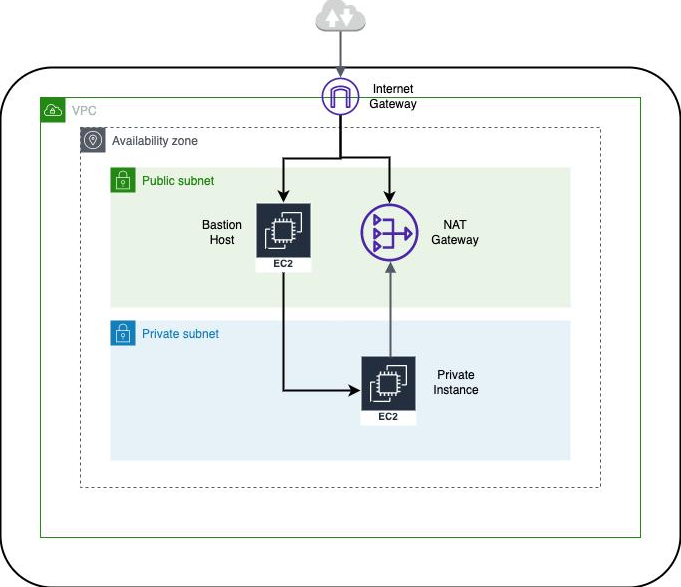
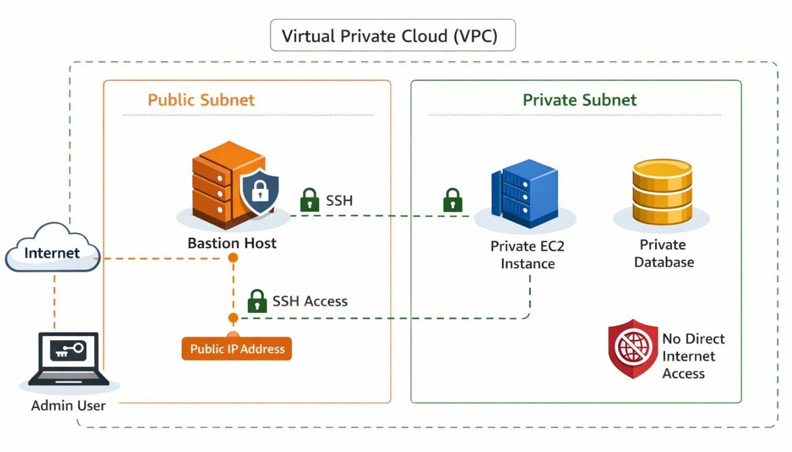
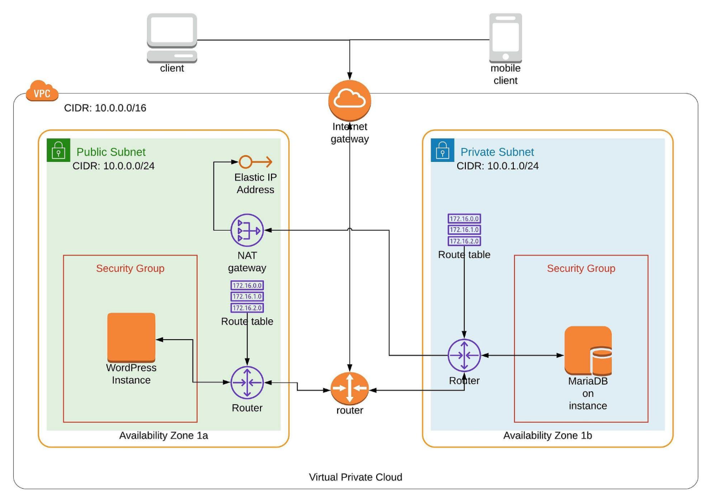
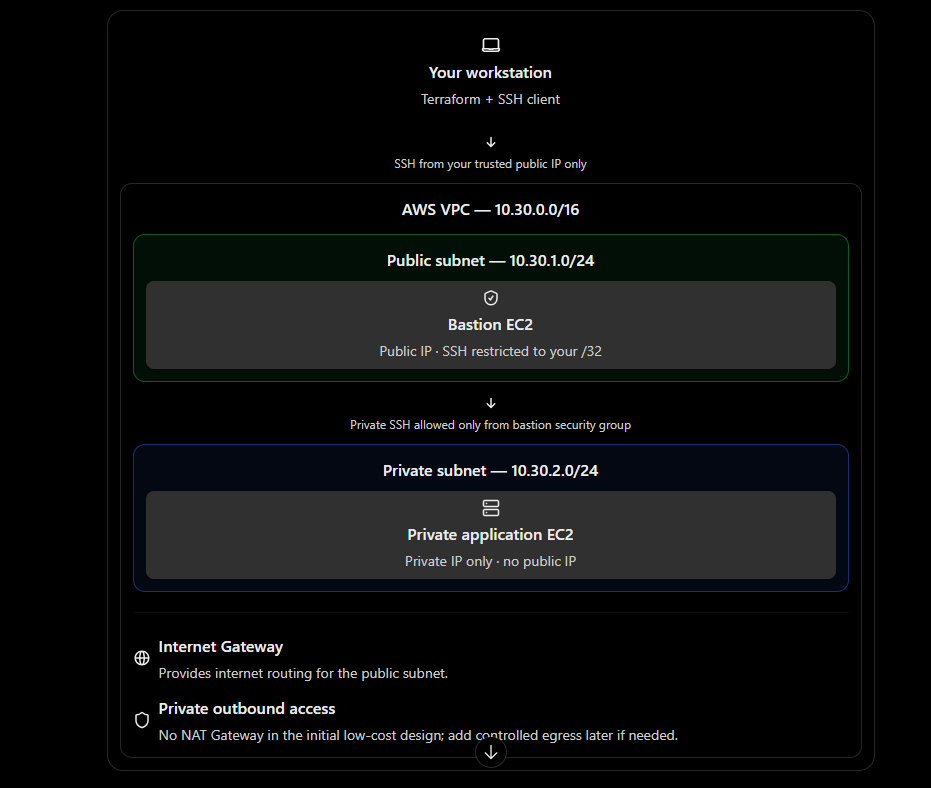

# Secure Cloud Network with Private Workloads — AWS






- We’ll build a secure AWS VPC using Terraform, with a public bastion host for controlled administration and a private Linux application server that has no public IP address.

A. Our priority is to demonstrate three things to recruiters:

1. Network segmentation: public and private workloads live in separate subnets.
2. Controlled access: SSH is restricted to your trusted public IP and private-server access flows through the bastion.
3. Verifiable security: Terraform outputs and connectivity tests prove that the application server is not directly exposed to the internet.

## Deliverables

By the end, our repository will include:

- Terraform files for the network, subnets, routes, security rules, and Linux instances.
- An architecture diagram suitable for your GitHub README.
- Restricted SSH access and documented security boundaries.
- Connectivity tests demonstrating what is allowed and what is blocked.
- Evidence that the private VM has no public IP and cannot be reached directly from the internet.
- A README with deployment, verification, troubleshooting, and cleanup instructions.

2.Create the project directory

```bash
# Create a separate repository for Project 3.
mkdir -p ~/projects/secure-cloud-network/aws/terraform
cd ~/projects/secure-cloud-network

# Create folders for evidence and documentation.
mkdir -p docs/evidence scripts

# Confirm your AWS CLI is authenticated and check the selected account.
aws sts get-caller-identity
aws configure get region

# Confirm the SSH public key from your previous Linux hardening project exists.
test -f ~/.ssh/linux_hardening_ed25519.pub \
  && echo "Public SSH key found." \
  || echo "Public SSH key is missing."
```

## Repository structure

secure-cloud-network/
├── README.md
├── .gitignore
├── docs/
│   └── evidence/
├── scripts/
└── aws/
    └── terraform/
        ├── versions.tf
        ├── variables.tf
        ├── main.tf
        ├── outputs.tf
        └── terraform.tfvars.example

3.Configure Terraform

- Create the following files inside aws/terraform/.
- versions.tf main.tf variables.tf outputs.tf terraform.tfvars.example

4.Create your local variables file

```bash
cd ~/projects/secure-cloud-network/aws/terraform

# Create your private local configuration from the safe example.
cp terraform.tfvars.example terraform.tfvars

# Discover your current public IPv4 address.
curl -4 https://checkip.amazonaws.com
```

5a.Initialize, validate, and review the Terraform plan

```bash
cd ~/projects/secure-cloud-network/aws/terraform

# Download the AWS provider and initialize the Terraform working directory.
terraform init

# Check the configuration for syntax and internal consistency.
terraform fmt -recursive
terraform validate

# Preview the resources Terraform intends to create.
terraform plan -out=project3.tfplan

# Display the saved plan in readable form for a final review.
terraform show project3.tfplan
```

5b.Review the plan and confirm it contains:

- One VPC and two subnets.
- An Internet Gateway and public/private route tables.
- A bastion security group restricted to your /32.
- An application security group that permits SSH from the bastion security group only.
- Two small EC2 instances with encrypted root volumes.
- No NAT Gateway, load balancer, or unnecessary managed services.

6.Verify the deployment

- After a successful apply, collect the Terraform outputs:

```bash
# Display the network IDs and both VM addresses.
terraform output

# Capture the two addresses in shell variables for the checks below.
BASTION_IP="$(terraform output -raw bastion_public_ip)"
APP_PRIVATE_IP="$(terraform output -raw application_private_ip)"

# This should print "null" for the application's public IP output.
terraform output application_public_ip

# Inspect the two EC2 instances and their IP assignments.
aws ec2 describe-instances \
  --filters "Name=tag:Project,Values=secure-cloud-network" \
  --query 'Reservations[].Instances[].{Name:Tags[?Key==`Name`]|[0].Value,State:State.Name,PublicIP:PublicIpAddress,PrivateIP:PrivateIpAddress,Subnet:SubnetId}' \
  --output table
```

## Expected result

- The bastion has a public IPv4 address.
- The application VM has a private IPv4 address.
- The application VM's public IP is null.
- Both instances are in the expected public/private subnets.

Test 1 — Connect to the bastion

```bash
# Use the private key associated with the public key registered in EC2.
ssh -i ~/.ssh/linux_hardening_ed25519 \
  -o IdentitiesOnly=yes \
  "ubuntu@${BASTION_IP}"

- The first connection may ask you to verify the host fingerprint. Confirm it against the instance's SSH host-key fingerprint through a trusted method before accepting it. 
- Type exit to return to your local terminal after the test.
```

Test 2 — Connect to the private application VM through the bastion

- From your local WSL terminal, run:

```bash
# Open SSH to the private instance through the public bastion.
# The private key remains on your workstation; it is not copied to the bastion.
ssh -i ~/.ssh/linux_hardening_ed25519 \
  -o IdentitiesOnly=yes \
  -o "ProxyCommand=ssh -i ~/.ssh/linux_hardening_ed25519 -o IdentitiesOnly=yes -o StrictHostKeyChecking=accept-new -W %h:%p ubuntu@${BASTION_IP}" \
  -o StrictHostKeyChecking=accept-new \
  "ubuntu@${APP_PRIVATE_IP}"

- If the connection succeeds, run:

hostname
ip -brief address

- The private address should belong to 10.30.2.0/24. Note that StrictHostKeyChecking=accept-new is convenient for a disposable lab, but it does not independently verify that the first-seen host is genuine; production workflows should verify host keys more rigorously.
```

Test 3 — Verify the security groups and routes.

- Run these commands from the Terraform directory:

```bash
# Inspect the security groups and their inbound rules.
aws ec2 describe-security-groups \
  --filters "Name=tag:Name,Values=secure-cloud-network-bastion-sg,secure-cloud-network-application-sg" \
  --query 'SecurityGroups[].{Name:GroupName,Inbound:IpPermissions}' \
  --output json

# Inspect route tables associated with the project VPC.
VPC_ID="$(terraform output -raw vpc_id)"

aws ec2 describe-route-tables \
  --filters "Name=vpc-id,Values=${VPC_ID}" \
  --query 'RouteTables[].{RouteTableId:RouteTableId,Associations:Associations[].SubnetId,Routes:Routes[].{Destination:DestinationCidrBlock,Gateway:GatewayId,State:State}}' \
  --output json
```

## Expected security behavior

```bash
Test                                                                              Expected result

SSH to bastion from your trusted IP                                               Allowed, if routing and the VM are healthy
SSH to bastion from an unapproved public IP                                       Blocked by its security group
SSH to application directly from the internet                                     Not possible through a public IP; the VM has none
SSH to application from the bastion                                               Allowed by the application security group
Private subnet default route to an Internet Gateway/NAT Gateway                   Absent
```

- The private VM may still be reachable from other resources in the VPC if their security rules permit it. A private IP alone is not a complete security boundary; routing and security groups must be reviewed together.

## Configure Jenkins

- Create a Pipeline job named secure-cloud-network-ci and configure it to use your repository's Jenkinsfile.

The Jenkins agent needs:

- Git, Terraform, and AWS CLI.
- Checkov installed for the required Terraform security scan.
- AWS credentials with only the permissions needed to inspect resources and generate a plan.
- A valid aws/terraform/terraform.tfvars file supplied securely by your deployment process if you want the plan stage to run.

## What this pipeline validates

```bash
Stage                                         Purpose

Formatting and validation                     Catch Terraform formatting and configuration errors
Checkov                                       Identify common Terraform and AWS security misconfigurations
Plan                                          Preview infrastructure changes without applying them
Cleanup                                       Remove local plan and state artifacts
```

- One important limitation: a successful Terraform validation or Checkov scan does not prove that the deployed network behaves correctly.
- For a later deployment pipeline, add post-deployment checks that inspect the actual AWS route tables and security groups, verify that the private instance has no public IP, and test that SSH works through the bastion but is not directly reachable from the internet.
- Keep terraform apply behind a manual approval stage.
